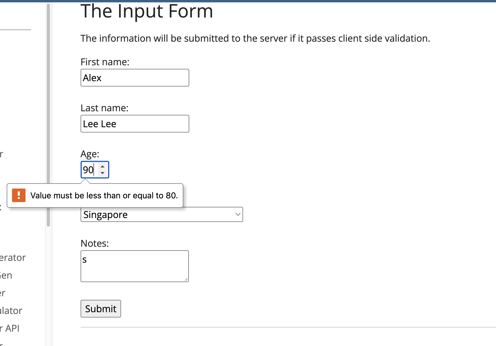

# Manual Testing Results — Member C

## Environment

| Item | Details |
|---|---|
| Tester identifier | member-c |
| Date and time | 5 nov |
| Browser and version | chrome |
| Operating system | macos |

## Login Tests

### Test ID: LOGIN-N02

| Item | Details |
|---|---|
| Test type | Negative |
| Tester | Member c|
| Website | https://www.saucedemo.com/ |
| Status | run |

#### Purpose

This test checks whether users can log in with a missing username.

#### Preconditions

The the the browser is to be open on the website

#### Test Data

| Field | Value |
|---|---|
| Input name | Input value |

#### Steps

1. Leave username field empty
2. Type in password as provided
3. Press Enter

#### Expected Result

Website will reject the login

#### Actual Result

He rejected the login with a epic sad face, username not provided.

#### Evidence

[ev](../evidence/member-c/image.png)

---

## Equivalence Partitioning
### Test ID: AGE-EP-90-C

| Item | Details |
|---|---|
| Test type | Negative |
| Tester | Member c|
| Website | https://www.saucedemo.com/ |
| Status | run |

#### Purpose

Check validation for age, equivalence testing out of the boundary

#### Preconditions

All other fields filled correctly

#### Steps

1. fill age as 90

#### Expected Result

Validation failed

#### Actual Result

Value must be less than or equals to eighty.

#### Evidence

---

## 2-Point Boundary Tests

### Test ID: AGE-2P-17-A

| Item | Details |
|---|---|
| Test type | Negative |
| Tester | member-a |
| Website | Test Pages validation form |
| Technique | 2-point boundary testing |
| Status | Not run |

#### Purpose

Check that an age immediately below the minimum is rejected.

#### Preconditions

The validation form is open.
All other fields will use the agreed valid baseline.

#### Test Data

| Field | Value |
|---|---|
| Age | `80` |
| Other fields | Agreed valid baseline |

#### Steps

1. Restore the validation form.
2. Enter the agreed baseline.
3. Replace age with `80`.
4. Submit.
5. Observe the response.

#### Expected Result

Age  80 accepted because it is below or equal to the max 80 age.

#### Actual Result

Accepted

#### Evidence

Not captured.

[test](../evidence/member-c/2bound.png)

## 3-Point Boundary Tests