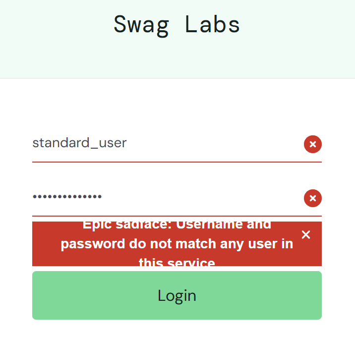
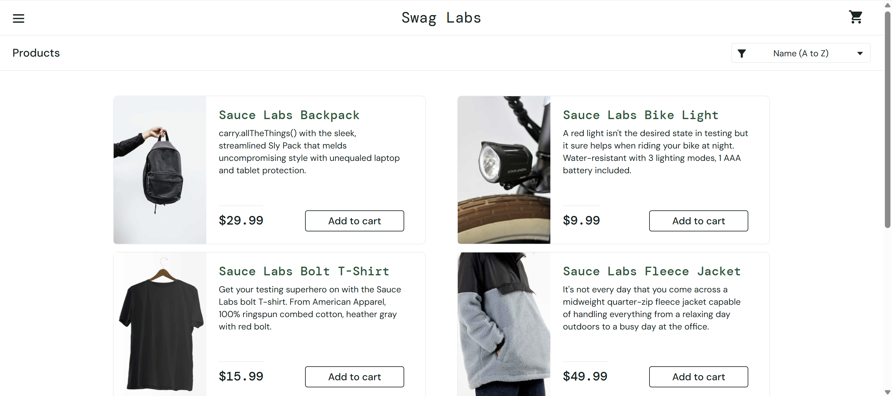

# Manual Testing Results — Member E

## Environment

| Item | Details |
|---|---|
| Tester identifier | member-e |
| Date and time | 5/11/2026 |
| Browser and version | Chrome 157.0.8103.39 |
| Operating system | Windows 11 |

## Login Tests
### Test ID: LOGIN-R01

| Item | Details |
|---|---|
| Test type | Recovery |
| Tester | member-e |
| Website | Swag Labs (saucedemo.com) |
| Status | Run |

#### Purpose

This test checks that if the user enters the wrong password initially, the login is rejected, and if the password is corrected the login is successful.

#### Preconditions

- User must be logged out initially
- Input fields start empty
- User has tried an invalid login before

#### Test Data

| Field | Value |
|---|---|
| Username | standard_user |
| Password | wrong_password |
| Password | secret_sauce |

#### Steps

1. Enter standard_user and wrong_password.
2. Select Login.
3. Confirm rejection.
4. Replace the password with secret_sauce.
5. Keep the username unchanged.
6. Select Login again.
7. Check whether the inventory appears.

#### Expected Result

The invalid attempt is rejected. After correcting the password, login succeeds.

#### Actual Result

The invalid login attempt is rejected and an error message is displayed. After correcting the password, login succeeds and the inventory page with products is visible.

#### Evidence
Rejection of wrong password:

Successfully reached inventory page after correction:

---

## Equivalence Partitioning

## 2-Point Boundary Tests

## 3-Point Boundary Tests

