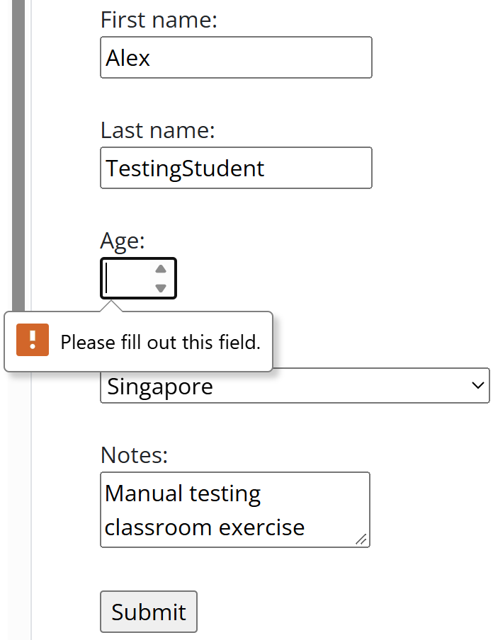
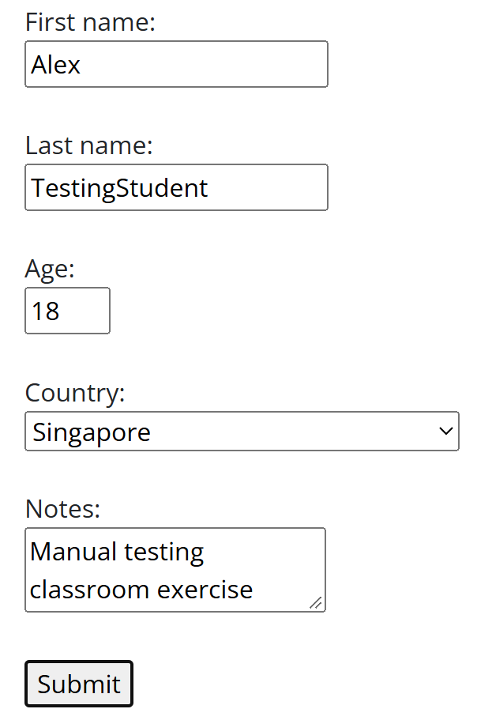
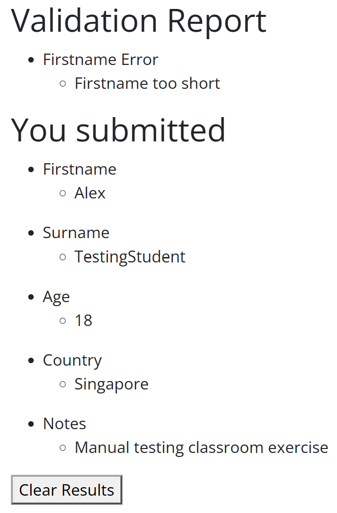
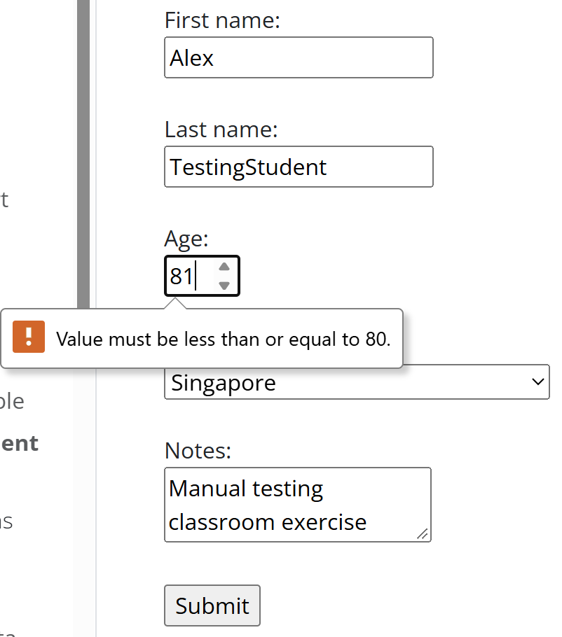

# Manual Testing Results — Member E

## Environment

| Item | Details |
|---|---|
| Tester identifier | member-e |
| Date and time | 5/11/2026 |
| Browser and version | Chrome 157.0.8103.39 |
| Operating system | Windows 11 |

## Login Tests
### Test ID: LOGIN-R01

| Item | Details |
|---|---|
| Test type | Recovery |
| Tester | member-e |
| Website | Swag Labs |
| Status | Pass |

#### Purpose

Checks that if the user enters the wrong password initially, the login is rejected, and if the password is corrected the login is successful.

#### Preconditions

- User must be logged out initially
- Input fields start empty
- User has tried an invalid login before

#### Test Data

| Field | Value |
|---|---|
| Username | `standard_user` |
| Password (1st attempt) | `wrong_password` |
| Password (2nd attempt) | `secret_sauce` |

#### Steps

1. Enter standard_user and wrong_password.
2. Select Login.
3. Confirm rejection.
4. Replace the password with secret_sauce.
5. Keep the username unchanged.
6. Select Login again.
7. Check whether the inventory appears.

#### Expected Result

The invalid attempt is rejected. After correcting the password, login succeeds.

#### Actual Result

The invalid login attempt is rejected and an error message is displayed. After correcting the password, login succeeds and the inventory page with products is visible.

#### Evidence

Rejection of wrong password:

Successfully reached inventory page after correction:

## Equivalence Partitioning
### Test ID: AGE-EP-abc-E

| Item | Details |
|---|---|
| Test type | Negative |
| Tester | member-e |
| Website | Test Pages Validation Form |
| Status | Observation only |

#### Purpose

Checks whether the user can enter abc as an age value, and whether it is accepted or rejected.

#### Preconditions

- All other baseline values are unchanged

#### Test Data

| Field | Value |
|---|---|
| First name | Alex |
| Surname | TestingStudent |
| Age | `abc` |
| Country | Singapore |
| Notes | Manual testing classroom exercise

#### Steps

1. Restore the form.
2. Enter the valid baseline.
3. Change only age.
4. Write the expected result.
5. Submit.
6. Observe acceptance or rejection.
7. Where displayed, verify the submitted age.
8. Record the actual result and status in a separate test-case block.

#### Actual Result

- The input cannot be entered in the field at all.
- If "submit" is clicked, An error message appears prompting to fill out the age field (it is considered empty)
- Requirement defines the expected behaviour as the age value only accepts numerical values between 18 and 80.

#### Evidence

"abc" can't be entered and if "submit" is clicked anyway an error message appears:

## 2-Point Boundary Tests
### Test ID: AGE-2P-18-81-D

| Item | Details |
|---|---|
| Test type | Positive & Negative |
| Tester | member-e |
| Website | Test Pages Validation Form |
| Technique | 2-point boundary testing |
| Status | Passed |

#### Purpose

Check that an age that is exactly the minimum is accepted and an age that is immediately above the maximum is rejected, and that these results are consistent throughout multiple attempts.

#### Preconditions

- The validation form is open.
- All other fields will use the agreed valid baseline.

#### Test Data

| Field | Value |
|---|---|
| Age | `18`, `81` (repeat) |
| Other fields | Agreed valid baseline |

#### Steps

1. Restore the validation form.
2. Enter the agreed baseline.
3. Change age with 18 for the first attempt, then change it to 81 on the second attempt.
4. Repeat step 3 one more time.
5. Submit.
6. Observe the response.

#### Expected Result

Entering 18 will be valid but entering 81 will be invalid.

#### Actual Result

Age 18 is accepted because it is the minimum age. However, age 81 is rejected because it is above the maximum age. 

#### Evidence

18 can be entered (no error message appears):

The form submitted:

81 cannot be entered, with error message:

## 3-Point Boundary Tests

